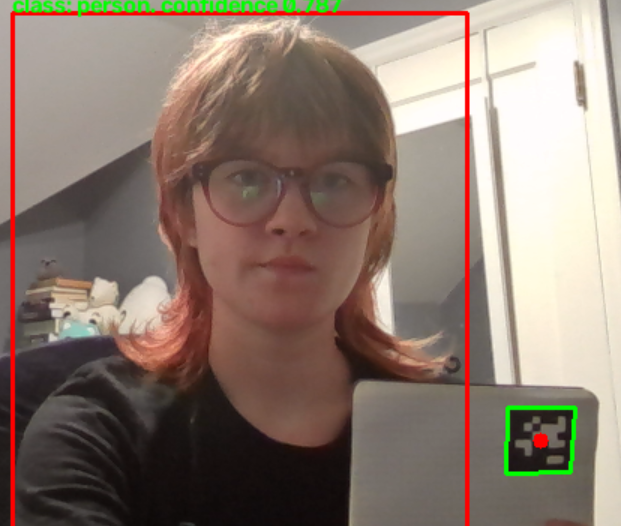
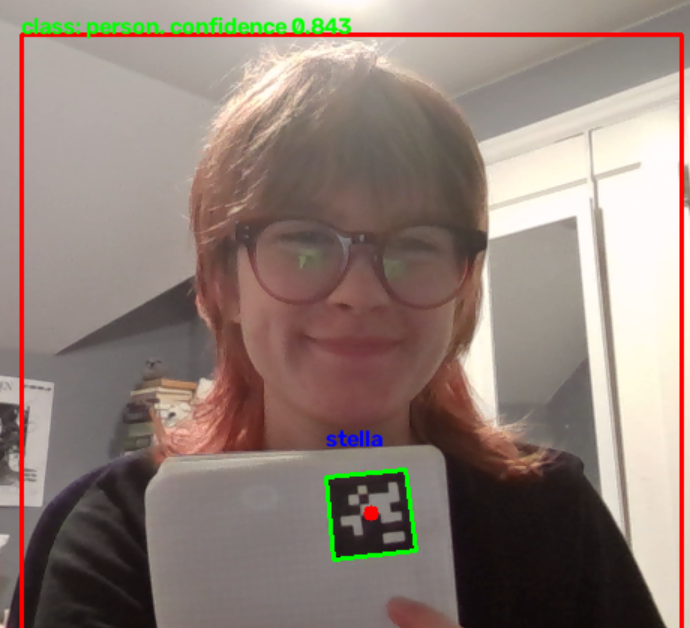

# Initial testing for the project

## Comparison of different models
In [this video](https://youtu.be/T5Sdp9LRbYQ) you can see how three models detect different things as wildfires. I recommend setting quality as high as possible and setting the playback speed to 0.25 to better understand what's going on. 

That compares these three models:

[yolo26m-UAV-fire-smoke-detection](https://huggingface.co/xiazh0219/yolo26m-UAV-fire-smoke-detection)

[YOLOv10-Fire-and-Smoke-Detection](https://huggingface.co/TommyNgx/YOLOv10-Fire-and-Smoke-Detection)

[yolov26-fire-detection](https://huggingface.co/SalahALHaismawi/yolov26-fire-detection/tree/main)

| Model | Average of preprocess |	Average of inference | StdDev of inference | Average of postprocess |
| ----- | --------------------- | -------------------- | ------------------- | ---------------------- |
| yolo_models/yolo26m-UAV-fire-smoke-detection.pt |	1.378775347	| 196.4084274 |	10.15393106 |	0.556997375 |
| yolo_models/YOLOv10-Fire-and-Smoke-Detection.pt	| 1.3429544	| 398.2888549	| 18.67942834	| 0.348619249 |
| yolo_models/yolov26-fire-detection.pt	| 1.378190736	| 77.37639341	| 5.595443642	| 0.332997118 |

## find_me.py
### Requirements:
All of the below requirements + Ollama (which requires both a pip install and a download).
It may 

## vision_test.py

### Requirements:
`pip install opencv-contrib-python pupil_apriltags ultralytics`

### Description:
Uses YOLO from ultralytics to identify a person in real-time webcam video, then checks whether there is an apriltag within the bounding box of the identified person, and if so, if it corresponds to a known person. 

e.g.: 

<table>
  <tr>
    <td width=400></td>
    <td width=400></td>
  </tr>
  <tr>
    <td>Since the apriltag is outside of the bounding box identifying me, it is not labelled as Stella.
</td>
    <td>Now that it is inside my bounding box, it gets labelled as Stella. 
</td>
  </tr>
</table>
On my machine, this runs reasonably quickly. It does not yet work properly for multiple people and I have not tested the program in varying lighting conditions.

## audio_test.py
### Requirements:
SpeechRecognition needs CUDA version 12. Probably there are better package management solutions than what I ended up doing but here's what worked.

`pip install pyaudio SpeechRecognition faster-whisper schedule gputil `

`pip install cuda-toolkit[all]==12.8`

### Description:
This transcribes the user's speech in real-time. Mostly copied from [this repo](https://github.com/davabase/whisper_real_time) modified to instead use the faster-whisper library, which claims to be faster and more memory-efficient than the OpenAI Whisper model. It also optionally logs gpu utilization information in a csv. Maybe more interesting though is watching nvitop while speaking (pip installation required) - significant spikes occur while speaking/transcribing. 

Note while running - first time using a model it will need to be downloaded, which can take a while. After it prints Model loaded, the user should speak and their words will be transcribed. I have not yet looked at the difference in accuracy between the different size models or the resource usage of each. 
